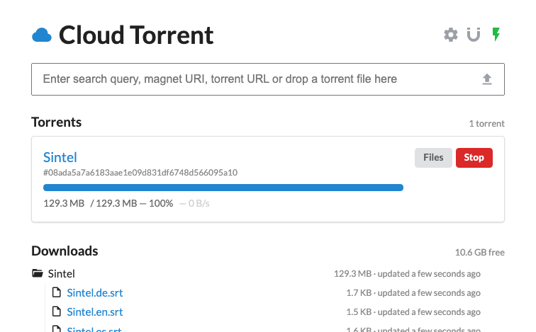

# Cloud Torrent

**Cloud Torrent** is a self-hosted remote torrent client: you add torrents
remotely, they download to the server's disk as sets of files, and you browse
or stream those files over HTTP.

This is a ground-up rewrite of the original
[cloud-torrent](https://github.com/jpillora/cloud-torrent) — a **Go** backend
([anacrolix/torrent](https://github.com/anacrolix/torrent) engine,
[jpillora/velox](https://github.com/jpillora/velox) realtime sync) with a
**Vue 3 + Vite + TypeScript** frontend, all compiled into a single binary.

### Features

* Single binary, cross-platform
* Add torrents by magnet, `.torrent` URL, or drag-and-drop upload
* Embedded torrent search ([jpillora/scraper](https://github.com/jpillora/scraper))
* Real-time updates (no refresh)
* Inline media previews (audio / image / video) with spacebar play/pause
* Mobile-friendly
* Fast [content server](https://pkg.go.dev/net/http#ServeContent) (stream while downloading)

### Install

**Binaries**

[](https://github.com/jpillora/cloud-torrent/releases)

Download binaries from [GitHub Releases](https://github.com/jpillora/cloud-torrent/releases). New releases are published as prereleases for Linux, macOS, and Windows.

**Docker**

Docker image publishing is disabled. To build and run the current source locally:

```sh
docker build -f .dev/Dockerfile -t cloud-torrent .
docker run -d -p 3000:3000 -v /path/to/downloads:/downloads cloud-torrent
```

**Source**

*[Go](https://go.dev/dl/) 1.27.3+, [Node](https://nodejs.org) 24+, and [Bun](https://bun.sh) 1.4.4+ are required.*

```sh
git clone https://github.com/jpillora/cloud-torrent
cd cloud-torrent
./dev.ts build                   # builds the SPA and dist/cloud-torrent
./dist/cloud-torrent --port 3000
```

### Usage

```
$ cloud-torrent --help

  Usage: cloud-torrent [options]

  Options:
  --title, -t        Title of this instance (default Cloud Torrent)
  --port, -p         Listening port (default 3000)
  --host, -h         Listening interface (default all)
  --auth, -a         Optional basic auth in form 'user:password'
  --config-path, -c  Configuration file path (default cloud-torrent.json)
  --key-path, -k     TLS Key file path
  --cert-path        TLS Certificate file path
  --log, -l          Enable request logging
  --open, -o         Open browser after the server starts
  --version, -v      display version
  --help             display help
```

The download directory and engine options are configured in the UI (gear icon)
and persisted to `cloud-torrent.json`.

### Development

The Go structs are the single source of truth for data shapes; the TypeScript
types are generated from them with [tygo](https://github.com/gzuidhof/tygo).
Build commands use [Take](https://github.com/jpillora/take) via `./dev.ts`;
run `./dev.ts --help` to list commands. Build and release configuration lives in `.dev/`.

```sh
./dev.ts gen-types                # regenerate frontend/src/types/*.gen.ts
./dev.ts check-types              # CI guard: regenerate + fail if stale
npm --prefix frontend run dev     # Vite dev server (proxies /sync /api -> :3000)
./dev.ts test                     # backend tests
./dev.ts ci                       # the complete CI pipeline
```

### Credits

Powered by [anacrolix/torrent](https://github.com/anacrolix/torrent). A rewrite
of the original [Node version](https://github.com/jpillora/node-torrent-cloud).
